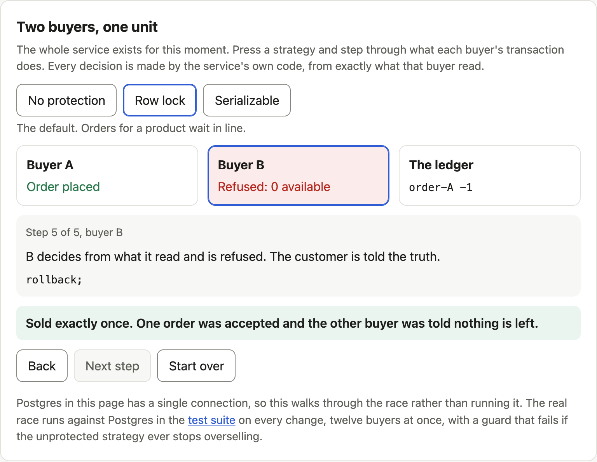

# inventory-reservations

**An inventory service that keeps two customers from buying the last unit of the same product.**

It is a Node and TypeScript service over Postgres. What is promised to orders is kept as a history
that is never changed, beside the count on hand, so when the warehouse count disagrees there is
something to compare it with. The demo runs this service's own store code against Postgres in the
page, with the same schema, roles and row level security as a deployment, so there is nothing to
install.

**[Open the demo](https://jasonsdevspace.com/inventory-reservations/)** ·
[Read how it works](https://jasonsdevspace.com/inventory-reservations/about/) ·
[Read the benchmark](docs/benchmarks/results.md)

<p><a href="https://jasonsdevspace.com/inventory-reservations/"><picture>
<source media="(prefers-color-scheme: dark)" srcset=".github/readme/race-dark.png">

</picture></a></p>

## Why I built it

On a previous team I led, inventory was one of those problems that looks simple until two people
want the last unit at the same moment. This is a small, complete example of how I approach that kind
of problem. Model the domain honestly, prove the failure with a test before fixing it, and treat
security and operations as part of the work from the start. These are what it promises, and each has
a test that fails without the fix.

- **The last unit sells exactly once.** This holds under real concurrency, and with the protection
  turned off the same race lets more than one order through.
- **Every change to stock can be explained afterward.** No line of the history is ever updated or
  deleted, even by the database's owner.
- **Nothing is ordered twice or held forever.** A retried request gets the first answer again, and
  an abandoned checkout gives its stock back on its own.
- **One merchant never sees another's stock.** Merchants share one database, and a query with a bug
  in it still sees only one merchant's rows.

## A path through the demo

The demo starts Postgres in your browser and says so while it does. Each link opens the demo at
the right place.

- **[Two buyers, one unit](https://jasonsdevspace.com/inventory-reservations/#race).** Press "No
  protection", then "Next step" to the end, then press "Row lock" and do it again.
- **[A second try with the same receipt](https://jasonsdevspace.com/inventory-reservations/#live).**
  Place an order, then press "Retry the last order".
- **[The cart that walked away](https://jasonsdevspace.com/inventory-reservations/#live).** Press
  "Hold for checkout" and wait a minute.
- **[The number somebody edited](https://jasonsdevspace.com/inventory-reservations/#rules).** Under
  "Try to break it", press "Try it" on "Edit a ledger entry as the service", then on "Edit it as the
  database owner".
- **[One store seeing another's stock](https://jasonsdevspace.com/inventory-reservations/#rules).**
  Under "Try to break it", press "Try it" on "Read stock without saying whose".
- **[The mistake nobody noticed](https://jasonsdevspace.com/inventory-reservations/#rules).** Press
  "Write a bad entry", then "Run reconciliation", then "Fix it with a compensating entry".

The rest of this page is for engineers.

## The design, in short

**The problem.** A product has one unit left and two checkouts ask for it at the same moment. Both
read one available, both are told yes, and the store has sold something it does not have. The
usual design, one quantity that each order decrements, also loses the reason behind every change,
so when the warehouse count disagrees there is nothing to compare it with.

**The outcome.**

- Physical stock, what is in the warehouse, is one number that changes only when goods ship. What is
  promised to orders is an append-only ledger beside it, and available stock is worked out from the
  two on every read, so it cannot drift.
- The ledger alone would still oversell, so orders for the same product take a row lock and queue,
  and each one reads the order before it. The last unit sells exactly once.
- The cost is waiting. On a hot product orders take turns, so latency grows with the queue and one
  product's throughput has a ceiling, as the [benchmark](docs/benchmarks/results.md) measured.
- Retried requests are answered from an idempotency key, checkout holds expire on their own, and a
  reconciliation job reports any ledger that breaks the rules.
- Tenancy is enforced twice, by the API key and by Postgres row level security, and the service
  runs as a role that cannot delete anything.
- It ships as a distroless container with health and readiness probes, scheduled jobs that run from
  the same image, and logs that never contain keys. The image is built from base images pinned by
  digest, scanned before it is published, and published with its bill of materials and build
  provenance.

## The gotchas, and the test behind each

Each promise has a test that fails if the promise stops being true. The tests use a real Postgres
database: the container you start under Run the service, or a Postgres service in CI.

- No ledger entry can be updated or deleted, even by the database's owner. Tested in
  [`src/postgres/store/store.test.ts`](src/postgres/store/store.test.ts).
- When 12 orders arrive at once for the last unit, exactly one succeeds. Tested in
  [`src/postgres/store/store.test.ts`](src/postgres/store/store.test.ts).
- With the protection turned off, the same race lets more than one order through. That shows the
  exactly-once test is checking something real. Tested in
  [`src/postgres/store/store.test.ts`](src/postgres/store/store.test.ts).
- A retried request gets the first answer again, not a second order. Tested in
  [`src/postgres/idempotency/idempotency.test.ts`](src/postgres/idempotency/idempotency.test.ts).
- An abandoned checkout hold expires and gives its stock back on its own. Tested in
  [`src/postgres/holds/holds.test.ts`](src/postgres/holds/holds.test.ts).
- A query that forgets to filter by merchant still sees only one merchant's stock. Tested in
  [`src/postgres/security/security.test.ts`](src/postgres/security/security.test.ts).
- The service runs as a role that cannot delete stock or reservations. Tested in
  [`src/postgres/security/security.test.ts`](src/postgres/security/security.test.ts).
- The reconciliation job reports a broken history and changes nothing. Tested in
  [`src/postgres/reconcile/reconcile.test.ts`](src/postgres/reconcile/reconcile.test.ts).

## What was measured

From the [contention benchmark](docs/benchmarks/results.md), run on a laptop with 32 buyers on one
product, row locking accepts every order, while serializable transactions, which retry instead of
waiting, refuse an order once its retries run out.

| Strategy     | Orders a second | Slowest 1% | Refused   |
| ------------ | --------------- | ---------- | --------- |
| Row lock     | about 700       | 56 ms      | none      |
| Serializable | about 320       | 584 ms     | 47 of 600 |

## Decisions

Each record names the option it rejected and what the choice costs.

1. [A ledger instead of a quantity](docs/decisions/0001-a-ledger-instead-of-a-quantity.md). A full
   history instead of a number that gets changed, at the cost of reads that grow with it.
2. [Row locking over serializable transactions](docs/decisions/0002-row-lock-over-serializable.md).
   Orders for one product wait in line, which caps that product's throughput, rather than retrying,
   which the benchmark showed costing far more, even when every buyer ordered a different product.
3. [Idempotency keys](docs/decisions/0003-idempotency-keys.md). Claimed in the same transaction as
   the work, and kept long enough to outlast every caller's retries.
4. [Checkout holds, and how they expire](docs/decisions/0004-checkout-holds-and-expiry.md). Skipped
   on read the moment they expire, and recorded by a cleanup job afterward, rather than either alone.
5. [Reconciliation detects, and does not repair](docs/decisions/0005-reconciliation-detects-but-does-not-repair.md).
   An automatic fix would guess, and write a second mistake over the first.
6. [Tenancy is enforced twice: in the query, and again by Postgres](docs/decisions/0006-tenancy-with-row-level-security.md).
   A query that forgets its filter sees one merchant's rows and one with no merchant sees none,
   never everything, and the service runs as a role that can never delete, at the cost of one
   setting per transaction.
7. [Publish only the image that was scanned](docs/decisions/0007-publish-only-what-was-scanned.md).
   A finding fails the build when it can be fixed, an acceptance expires, and what ships is the
   exact image that was checked, at the cost of deadlines someone has to meet.
8. [Visits to the demo are counted by path, with Plausible](docs/decisions/0008-visits-are-counted-by-path.md).
   One site for the whole domain, no cookie, only paths sent, and nothing counted under Global
   Privacy Control, at the cost of about 3 KB of script on both pages and counts an ad blocker can
   lower.

<details>
<summary>Where a stale answer is acceptable, and where it is not</summary>

| Read                              | Can it be stale? | Why                                                                      |
| --------------------------------- | ---------------- | ------------------------------------------------------------------------ |
| Available stock on a product page | Yes              | Nothing is promised until the order is placed                            |
| Placing an order or a hold        | No               | Read and written under the row lock, in one transaction                  |
| Converting a hold into an order   | No               | Under the same lock, with the time read after waiting for it             |
| Recording that a hold expired     | Yes, until a run | Reads already skip an expired hold, so the record only completes history |
| Removing old idempotency keys     | Yes              | A key only has to outlast the caller's retries                           |
| Reconciliation's report           | Yes, by a day    | It finds mistakes in history, and no customer waits on it                |

</details>

<details>
<summary>What this does not handle</summary>

- Several warehouses or stock sources per product. Each product has one physical quantity.
- Payments, carts and accounts. A checkout hold is the only checkout concept.
- An order covering several products at once. Every command locks one stock row, and locking
  several would need a fixed order to avoid deadlocks, as decision record 2 notes.
- Receiving goods or recording a stock count through the API. Physical stock changes only when an
  order ships, and an operator corrects the ledger with an `adjustment` entry.
- Periodic balances for products with very long histories, the remedy decision record 1 describes.
- Authentication beyond API keys, such as user accounts or per-user permissions.

</details>

## How it works

<details>
<summary>The ledger, with append-only entries and available stock derived on every read</summary>

Each product has a physical quantity and a list of reservation entries. Entries are never updated
or deleted, and a database trigger enforces that.

- **Placing an order** adds a negative entry. Physical stock does not move.
- **Shipping** adds a matching positive entry and lowers physical stock.
- **Canceling** adds a matching positive entry and leaves physical stock alone.

Available stock is physical stock plus the sum of the entries. It is computed on every read and
never stored, so it cannot drift.

</details>

<details>
<summary>Preventing oversells, with three concurrency strategies and one wrong on purpose</summary>

The ledger records an oversell faithfully but does nothing to stop one. Two checkouts can read the
same stock at the same moment and both be told yes. `CONCURRENCY_STRATEGY` picks the protection.

| Strategy             | How it works                                        | Twelve orders for one unit |
| -------------------- | --------------------------------------------------- | -------------------------- |
| `none`               | No protection, kept to prove the bug is real        | more than 1 succeeds       |
| `row_lock` (default) | Locks the stock row, so orders for a SKU queue      | exactly 1 succeeds         |
| `serializable`       | Postgres detects the conflict and the loser retries | exactly 1 succeeds         |

The test suite asserts that `none` really does oversell. If the race test ever stops producing
real contention, it fails instead of quietly passing.

What each correct strategy costs as more buyers compete is measured in the
[contention benchmark](docs/benchmarks/results.md). Run `npm run bench` with the containers up to
reproduce it on your machine.

</details>

<details>
<summary>Oversell policy, to sell strictly, hold some back or allow backorders</summary>

Not every business wants zero oversell. `OVERSELL_POLICY` sets the rule.

| Policy        | Meaning                                                |
| ------------- | ------------------------------------------------------ |
| `strict`      | Sell only what is available (default)                  |
| `threshold:N` | Hold N units back, for example for in-store customers  |
| `backorder:N` | Allow up to N units past what is available, on purpose |

To try one, restart the API with it set:

```bash
OVERSELL_POLICY=backorder:10 docker compose up -d --force-recreate api
```

</details>

<details>
<summary>Idempotency, where a retried request gets the original answer</summary>

Send an `Idempotency-Key` header and a retried request gets the original response instead of
doing the work twice. Keys are scoped per merchant and per endpoint. Reusing a key with a different
request body returns a 422. The key is saved in the same transaction as the order, so a crash can
never leave one without the other.

</details>

<details>
<summary>Checkout holds, which set stock aside for a few minutes and free it the moment they expire</summary>

An order is a commitment, so it keeps its stock until it ships or is canceled. A checkout that has
not finished is different, because the shopper might leave. Its stock is set aside by a hold,
which runs out.

- Each merchant sets how long its holds last, 15 minutes by default. An extension gives a full
  lifetime again, up to one hour from when the hold was first placed.
- Available stock skips a hold the moment it expires, so a cart left open never keeps stock off
  sale, even before anything else has run.
- A cleanup job, `npm run expire-holds`, then records the release in the ledger, so every hold's
  history shows how it ended. It runs with the service's own restricted rights.
- Expiry is decided by the database clock, read after any wait for a lock, so servers whose clocks
  drift still agree on whether a hold has run out.

The reasoning, and the options it rules out, are in
[decision record 4](docs/decisions/0004-checkout-holds-and-expiry.md).

</details>

<details>
<summary>Security, with tenant isolation enforced twice and minimal database rights</summary>

- **The API key decides the merchant.** No request can name a different merchant. Keys are stored
  hashed.
- **Every query is scoped by merchant, and Postgres checks it again.** With row level security, a
  query that forgets its filter still sees only one merchant's rows.
- **The service runs with minimal database rights.** It cannot delete anything or change the
  schema. Migrations and cleanup run separately, as the owner. The service refuses to start with
  credentials that would bypass row level security.

</details>

<details>
<summary>Reliability, with probes, rate limits and timeouts</summary>

- `/health` and `/ready` are separate, so a database outage takes instances out of rotation
  without restarting them. They recover on their own when it returns.
- Each API key can make 600 requests a minute. Past that it gets a 429 with `Retry-After`, and
  the request is refused before it reaches the database.
- Every database call has a timeout on both sides, so a stalled database produces fast errors
  rather than hung requests.
- Errors returned to clients never include internal details. Each response carries an
  `X-Request-Id` that matches the server log.

</details>

## Dev setup

How to contribute is in [CONTRIBUTING.md](.github/CONTRIBUTING.md), and the accessibility the demo
is held to is in [ACCESSIBILITY.md](docs/ACCESSIBILITY.md).

### Prerequisites

| Tool                                                              | Needed for             | Check with               |
| ----------------------------------------------------------------- | ---------------------- | ------------------------ |
| [Docker Desktop](https://www.docker.com/products/docker-desktop/) | running the service    | `docker compose version` |
| [Git](https://git-scm.com/downloads)                              | cloning the repo       | `git --version`          |
| [Node.js 24](https://nodejs.org/)                                 | running the tests only | `node --version`         |

Docker Desktop includes Compose. On Linux, Docker Engine with the Compose plugin works the same.

### Run the service

1. Download the code and move into the project folder.

    ```bash
    git clone https://github.com/jasonsdevspace/inventory-reservations.git
    cd inventory-reservations
    ```

2. Build and start Postgres and the API in the background. This also applies the schema and loads
   the demo data.

    ```bash
    docker compose up -d --build
    ```

3. Check that the API is up and can reach its database.

    ```bash
    curl localhost:8080/ready
    ```

    It answers `{ "status": "ready" }`. The API is now on port 8080, and `docker compose down`
    stops it, as under [Stop it](#stop-it).

### Run the tests

The tests use the Postgres container started above, so leave it running.

1. Install the exact dependency versions recorded in `package-lock.json`, and the demo's, since
   the lint reads the demo's types too. Then set up the commit hooks by name, since the `.npmrc`
   turns npm's install scripts off and npm skips `prepare` with them.

    ```bash
    npm ci
    npm ci --prefix demo
    npm run prepare
    ```

2. Run every check CI runs: type checking, linting, formatting, a prose check, a check that
   everything names the Node version in `.nvmrc`, a check that npm runs no install scripts, and the
   tests.

    ```bash
    npm run verify
    ```

Use `npm test` instead for watch mode while you work.

### Check the demo

The demo carries [a page on how it works](https://jasonsdevspace.com/inventory-reservations/about/)
in plain words, linked from its strip, built beside it and held to the same audit.

<details>
<summary>What CI checks on the demo</summary>

CI builds the browser demo in `demo/` as it is published, visits it in Chromium on a desktop and a
phone with an axe audit on each visit, and audits it with Lighthouse: accessibility has to score a
hundred and search ninety, and the page has to stay inside budgets for its paint, layout shift and
the bytes it ships. The performance score is reported rather than gated, since Postgres starting in
the page counts as blocking time. The build those checks ran against is the one the deploy
publishes. Nothing here needs the Postgres container, since the demo starts its own in the page. The
browser tests and the audit write what they found to the run's page on GitHub: the tests' totals and
any that failed, and each page's figures against the gates. Every job runs on a named Ubuntu image
within a time limit, which `scripts/workflows.test.ts` holds.

</details>

1. Install the service's dependencies and the demo's, and Chromium for the browser tests the first
   time. The demo runs the service's code from `src`, which it reads through the root tsconfig, and
   that tsconfig extends the shared config package installed at the root.

    ```bash
    npm ci && npm ci --prefix demo
    cd demo
    npx playwright install chromium
    ```

2. Build the demo, then run the same checks CI runs: its tests, the browser tests and the Lighthouse
   audit.

    ```bash
    npm run build
    npm test
    npm run e2e
    npm run lighthouse
    ```

### Check the image

CI builds the image the service ships as on every run, scans it, and publishes from main only the
image it scanned.

<details>
<summary>What CI checks on the image</summary>

Each run builds it from base images pinned by digest, and scans it and both lockfiles. A high or
critical vulnerability with a fix available fails the build. Findings with no fix yet are listed in
their own step without failing it, since the fix is the next base image or release, and Dependabot
opens that pull request. A finding that does not apply is accepted in `.trivyignore.yaml`, scoped to
one package, with the reason and a date the acceptance expires, so it is looked at again rather than
kept forever. A check in CI, and a weekly scheduled run, warn thirty days before an acceptance
expires, and fail on one that no longer matches anything in its package. The acceptances there today
cover Debian's OpenSSL in the runtime image, which nothing loads, because Node carries its own.

</details>

<details>
<summary>How the image is published and released</summary>

A bill of materials is kept with every run. On main the image is pushed with its bill of materials
and a build provenance attestation attached, and that pushed image is the one scanned, in a job of
its own that can only read packages, so the scanner never holds a token that can write to the
registry. Once every check has passed it is tagged at
`ghcr.io/jasonsdevspace/inventory-reservations`, so what is published is exactly what was scanned.

Pushing a version tag such as `v0.5.0` releases that version. The release workflow checks the tag
against `package.json` and [the changelog](CHANGELOG.md), and finds the image CI published for that
commit, which exists only once every check on main has passed. It scans that image again against
the day's vulnerability data, in a job that can only read packages, gives it the version as its tag,
and creates a release on GitHub with the changelog entry as its notes and the image's own bill of
materials attached. The run's page names the release, the image and its digest.

</details>

Run the same scan locally with [Trivy](https://trivy.dev/) installed.

```bash
docker build -t inventory-reservations:local .
trivy image --severity HIGH,CRITICAL --ignore-unfixed \
  --ignorefile .trivyignore.yaml inventory-reservations:local
```

## Call the API from a terminal

With the service running, every request needs an API key. The demo data includes two merchants,
**Acme** (`demo-key-acme`) and **Globex** (`demo-key-globex`). Acme starts with these four products,
and Globex with 11 of its own `DEMO-1`.

| SKU              | On hand | Already reserved | Available |
| ---------------- | ------- | ---------------- | --------- |
| `DEMO-1`         | 5       | 0                | 5         |
| `DEMO-SCARCE`    | 1       | 0                | 1         |
| `DEMO-PLENTIFUL` | 500     | 0                | 500       |
| `DEMO-COMMITTED` | 10      | 3                | 7         |

Run the steps in order on fresh demo data, since some start from what an earlier step left.
Responses are shown formatted below. Add `| jq` to a command if you have it installed.

<details>
<summary>1. Check stock, where reserved units are not for sale</summary>

`DEMO-COMMITTED` has ten on hand, but three are reserved for an order that has
not shipped, so seven are available. `held` counts units set aside in checkouts, covered in step 6.

```bash
curl localhost:8080/inventory/DEMO-COMMITTED \
  --header 'x-api-key: demo-key-acme'
```

It answers this.

```json
{
    "sku": "DEMO-COMMITTED",
    "onHand": 10,
    "reserved": 3,
    "held": 0,
    "available": 7
}
```

</details>

<details>
<summary>2. Place an order, which a retry never places twice</summary>

The idempotency key makes the request safe to retry.

```bash
curl localhost:8080/orders \
  --header 'x-api-key: demo-key-acme' \
  --header 'content-type: application/json' \
  --header 'idempotency-key: first-order' \
  --data '{ "sku": "DEMO-1", "orderId": "order-1", "quantity": 2 }'
```

It answers this.

```json
{
    "entries": [
        { "sku": "DEMO-1", "orderId": "order-1", "quantity": -2, "reason": "order_placed" }
    ],
    "physicalDelta": 0
}
```

Run the same command again. You get the same answer and no second order is placed. Add `--include`
to see the `idempotency-replayed: true` header that marks it as a repeat.

</details>

<details>
<summary>3. Ship it, which lowers stock on hand but not available stock</summary>

The goods leave the warehouse, so stock on hand drops from 5 to 3. Available stock
stays at 3, because those two units were already spoken for.

```bash
curl localhost:8080/orders/order-1/shipments \
  --header 'x-api-key: demo-key-acme' \
  --header 'content-type: application/json' \
  --data '{ "sku": "DEMO-1", "quantity": 2 }'

curl localhost:8080/inventory/DEMO-1 \
  --header 'x-api-key: demo-key-acme'
```

The second command answers this.

```json
{
    "sku": "DEMO-1",
    "onHand": 3,
    "reserved": 0,
    "held": 0,
    "available": 3
}
```

</details>

<details>
<summary>4. Ask for more than exists, and the order is refused with a 409</summary>

The order is refused with a 409 that says what was available.

```bash
curl localhost:8080/orders \
  --header 'x-api-key: demo-key-acme' \
  --header 'content-type: application/json' \
  --data '{ "sku": "DEMO-SCARCE", "orderId": "order-2", "quantity": 4 }'
```

It answers this.

```json
{
    "error": {
        "kind": "insufficient_salable",
        "requested": 4,
        "available": 1
    }
}
```

</details>

<details>
<summary>5. Switch merchants, and see only that merchant's stock</summary>

Globex has its own `DEMO-1`, untouched by anything Acme did.

```bash
curl localhost:8080/inventory/DEMO-1 \
  --header 'x-api-key: demo-key-globex'
```

It answers this.

```json
{
    "sku": "DEMO-1",
    "onHand": 11,
    "reserved": 0,
    "held": 0,
    "available": 11
}
```

</details>

<details>
<summary>6. Hold stock at checkout, where a hold paid in time always becomes an order</summary>

Set the last unit of `DEMO-SCARCE` aside while a shopper pays. It stops being available straight
away, and the hold expires on its own after 15 minutes if nobody pays.

```bash
curl localhost:8080/holds \
  --header 'x-api-key: demo-key-acme' \
  --header 'content-type: application/json' \
  --data '{ "sku": "DEMO-SCARCE", "holdId": "cart-1", "quantity": 1 }'

curl localhost:8080/inventory/DEMO-SCARCE \
  --header 'x-api-key: demo-key-acme'
```

The second command answers this.

```json
{
    "sku": "DEMO-SCARCE",
    "onHand": 1,
    "reserved": 0,
    "held": 1,
    "available": 0
}
```

When the payment goes through, convert the hold into an order. This never fails for lack of
stock, because the unit was already set aside. A hold that has expired is answered with a 410 and
the quantity available instead.

```bash
curl localhost:8080/holds/cart-1/conversions \
  --header 'x-api-key: demo-key-acme' \
  --header 'content-type: application/json' \
  --header 'idempotency-key: pay-cart-1' \
  --data '{ "sku": "DEMO-SCARCE", "orderId": "order-3" }'
```

The unit now shows under `reserved` instead of `held`, and ships like any other order.

</details>

<details>
<summary>7. Break the ledger on purpose, so reconciliation finds it and a person fixes it</summary>

Write an entry straight into the database as its owner, the way a hand-written fix or a bug might.
This one cancels five units of an order that never reserved any.

```bash
docker compose exec postgres psql -U reservations -c \
  "insert into reservations (merchant_id, sku, order_id, quantity, reason)
   values ('acme', 'DEMO-PLENTIFUL', 'order-9', 5, 'order_canceled')"
```

Run reconciliation the way production would, through the image.

```bash
docker compose run --rm reconcile
```

It answers this.

```json
{
    "merchantId": "acme",
    "kind": "order_over_released",
    "sku": "DEMO-PLENTIFUL",
    "orderId": "order-9",
    "net": 5
}
```

It exits with status 1, which is what a scheduler would alert on. It does not fix anything. A
person decides the cancellation was entered by mistake, and records that with a compensating
entry, so the mistake and its fix both stay in the history.

```bash
docker compose exec postgres psql -U reservations -c \
  "insert into reservations (merchant_id, sku, order_id, quantity, reason)
   values ('acme', 'DEMO-PLENTIFUL', 'order-9', -5, 'adjustment')"

docker compose run --rm reconcile
```

The second run reports nothing wrong and exits 0.

</details>

### All endpoints

| Endpoint                         | What it does                                    |
| -------------------------------- | ----------------------------------------------- |
| `GET /inventory/:sku`            | Stock on hand, reserved and available           |
| `POST /orders`                   | Reserve stock for an order                      |
| `POST /orders/:id/shipments`     | Ship some or all of an order                    |
| `POST /orders/:id/cancellations` | Release some or all of an order                 |
| `POST /holds`                    | Set stock aside for a checkout                  |
| `POST /holds/:id/extensions`     | Give an active checkout more time               |
| `POST /holds/:id/conversions`    | Turn a hold into an order                       |
| `POST /holds/:id/releases`       | End a hold early, when a cart is abandoned      |
| `GET /health`                    | Whether the process is alive                    |
| `GET /ready`                     | Whether it can serve traffic, database included |

### Stop it

Stop and remove the containers. For development the database is kept in memory rather than on disk,
so this also clears it, and the next `up` starts fresh.

```bash
docker compose down
```

## Project layout

Each module sits in its own folder with its tests and any files it reads.

<details>
<summary>What each folder holds</summary>

- `demo/` holds the browser demo, the same store on Postgres in the page, with `about/`, the page
  on how it works, and `theme.js`, the script both pages run first.
- `src/domain/` holds the business logic, with no I/O.
    - `commands/` holds place, ship and cancel.
    - `holds/` holds checkout holds and their expiry.
    - `reconcile/` holds the rules a correct history keeps.
    - `ledger/` derives quantities from the entries.
    - `types.ts` holds the shared types, and `index.ts` is the public entry point.
- `src/http/` holds the API.
    - `server/` holds the routes, validation and error responses.
    - `policy/` reads `OVERSELL_POLICY`.
    - `main.ts` starts the service.
- `src/postgres/` holds everything that talks to the database.
    - `store/` runs commands under each concurrency strategy.
    - `holds/` holds the job that records expired holds.
    - `bench/` holds the contention benchmark.
    - `reconcile/` checks every ledger and reports what is wrong.
    - `idempotency/` holds the stored responses, plus the cleanup job.
    - `pool/` holds connections, tenancy and timeouts.
    - `merchants/` looks up API keys.
    - `migrate/` holds the schema, roles and the migration command.
    - `seed/` holds the demo data.
    - `security/` holds the tests for tenant isolation and database rights.
    - `testkit/` holds the shared test helpers.
- `scripts/` holds the Node check, the check of the image scan's accepted findings, the run
  summaries and the tests that read the whole repository.

</details>

## Configuration

Everything is set through environment variables, and the defaults match the Compose setup, so local
development needs none of them. The full list is in
[the operations guide's configuration](docs/operations.md#configuration), beside how to deploy the
service.

## Scheduled jobs

Three jobs keep the service healthy. Each is a script in the same image as the API, so production
runs them by starting that image with a different command. There is no npm in the image.

| Job          | What it does                                              | Connects as  | Suggested schedule |
| ------------ | --------------------------------------------------------- | ------------ | ------------------ |
| retention    | Deletes idempotency keys past their retention window      | owner        | hourly             |
| expire-holds | Records the end of checkout holds that expired            | service role | every minute       |
| reconcile    | Checks every ledger against the rules a correct one keeps | service role | daily              |

**Locally**, run any of them once the way production does, through the image:

```bash
docker compose run --rm reconcile
```

While developing, `npm run retention`, `npm run expire-holds` and `npm run reconcile` build the
code and run it directly instead.

Each job's command and environment are in the operations guide, under
[scheduling the jobs in production](docs/operations.md#scheduled-jobs).

## Background

The model follows the multi-source inventory design a widely used commerce platform documents
publicly. Physical stock is kept apart from reservations, shipments and cancellations add
compensating entries, and available stock is derived rather than stored.

## License

MIT. See [LICENSE](LICENSE).
